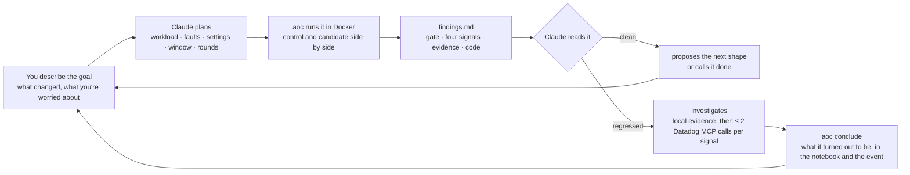
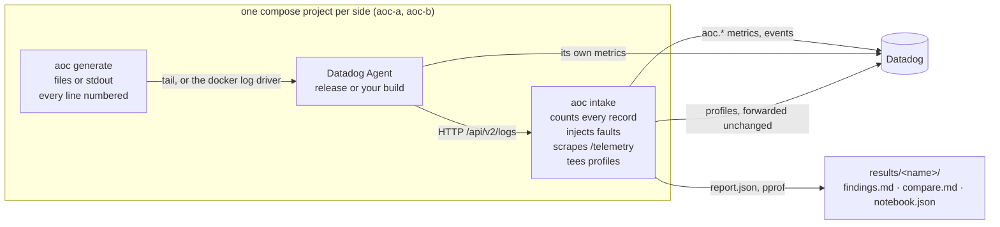

# agent_of_chaos

A local, agent-driven development loop for the Datadog Agent's logs
pipeline. You tell Claude Code what you changed or what you want to know;
it shapes the environment, runs the experiment in Docker, reads the brief,
tells you what moved and in which function, and proposes the next run.

```text
you:     I rewrote the sender's batching in my checkout. Is it slower behind a slow intake?
claude:  Building your working tree and main the same way, baseline workload, 500 ms ± 200 ms
         intake latency, 10 min window, 2 rounds. About 35 minutes. Running in the background.
         …
         pass. No signal crossed its threshold. cpu −1.2 %, memory +0.8 %, saturation flat
         (sender 0.41 → 0.39). The gate is clean: 0 lost, 0 duplicated on both sides.
         Next I'd run flaky-network, since batching changes usually show under dropped
         connections rather than plain latency. Want that?
```

This is not a replacement for CI. The agent's end-to-end suite and its
single-machine performance tests are the record of truth for a release.
This is for the hours before you push: a change in your working tree, an
answer in minutes, and an environment you can bend to the question
(the workload shape, the intake's faults, the agent's settings, how long
and how many rounds) without writing a test.

## The loop



Every run is one command line. Claude writes it, so you never have to;
the line is in the report, so you can rerun it yourself.

## Start

Docker, Go 1.25 or later, and a Datadog API key so metrics, profiles and
notebooks land in your org (an app key for notebook creation).

```bash
cp .env.example .env     # DD_API_KEY, optionally DD_APP_KEY
make build               # ./bin/aoc
claude                   # in this directory
```

The repository ships four skills in `.claude/skills/`; Claude picks the
one your question calls for. `/aoc` starts a session from a goal and
leads it to a conclusion. The others are what it delegates to:

| skill | when it fires | what it does |
|---|---|---|
| `aoc` | "I'm working on …, help me test it", "is my branch ready", "keep going" | turns a goal into a plan of experiments, runs them in order, reads each result and decides the next one |
| `ab-test` | "test my branch", "did master regress", "flag on vs off" | one `aoc ab` line from what you changed; runs it; reports the verdict |
| `experiment` | "what happens to the agent when …", "find the knee" | one `aoc run` line from a situation; runs it; reports delivery, latency and cost; sweeps a knob until something gives |
| `investigate` | "why did memory go up in results/x" | from the brief to a named function, with a bounded number of Datadog MCP calls, then `aoc conclude` |

A session's record is `results/<name>/` on disk and, in Datadog, the
`aoc.*` metrics, `source:aoc` events, the agent's own profiles and a
notebook, all tagged `experiment:<name> variant:a|b`.

## What you can ask

These are the questions the loop is built for. Each row is a real prompt,
the command Claude derives from it, and what comes back.

### Did my change regress the pipeline?

> **I changed the tailer's rotation handling on my branch. Does it lose
> anything under copytruncate?**

```bash
./bin/aoc ab --b-src . --a-src main --workload rotation-churn \
  --code pkg/logs/tailers --code pkg/logs/launchers \
  --focus "I changed the tailer's rotation handling. Does it lose anything under copytruncate?"
```

Both sides are built from your checkout the same way, so only the branch
differs. The gate (lost, duplicated, orphaned, truncated) is the headline;
the streams table in the brief says which rotation mode lost and where the
gaps sit relative to rotations. Claude then offers `chaos-restarts`, the
other tailer workload.

> **Master versus the release: did throughput regress?**

```bash
./bin/aoc ab --b datadog/agent-dev:master-py3 --workload deterministic-bytes \
  --focus "master vs release: did throughput regress?"
```

`deterministic-bytes` feeds both agents byte-identical input flat out, so
throughput is each agent's maximum and CPU seconds per million logs is
directly comparable.

> **I moved payload building off the sender's hot path. Is it slower or
> hungrier behind a slow intake?**

```bash
./bin/aoc ab --b-src . --a-src main --fault latency_ms=500,jitter_ms=200 \
  --code comp/logs-library/sender --focus "payload building off the hot path: slower or hungrier behind a slow intake?"
```

### Is a feature or a setting worth its cost?

> **Is auto multiline detection worth its CPU when a third of the lines are
> stack traces? Same build, flag on versus off.**

```bash
./bin/aoc ab --b datadog/agent:7 --workload multiline-heavy \
  --b-env DD_LOGS_CONFIG_AUTO_MULTI_LINE_DETECTION=true \
  --focus "is auto multiline detection worth its CPU at 35% stack traces?"
```

`--b-env` puts the flag on the candidate only. The brief reports orphan
continuation lines and "multiline received / written" next to the CPU
signal, so the answer is cost and benefit on one page.

> **Run the tag filter build with every tag key excluded at four times the
> baseline volume. Does the filter pay for itself?**

```bash
./bin/aoc ab --a datadog/agent-dev:log-tag-filtering-9e35a50b-full \
  --b datadog/agent-dev:log-tag-filtering-9e35a50b-full \
  --workload baseline --set rate=20000 --duration 5m \
  --b-env 'DD_LOGS_CONFIG_TAG_FILTERS={"exclude":["dirname:*","filename:*","log_format:*","project:*","multiline:*","container_id:*","container_name:*","docker_image:*","image_id:*","image_name:*","image_tag:*","short_image:*"]}' \
  --watch "tag bytes per log" --code comp/logs-library/tagfilter \
  --focus "tag filter, every tag key excluded, 4x volume: does it pay for itself?"
```

Same build on both sides, the flag on one. This one was run from this
checkout. The brief came back with core agent CPU 34.5 % → 30.9 %, Go
heap in use 104.9 MB → 88.2 MB, wire bytes −4 % even though the
compression ratio fell from 21.7× to 17.4×, and named the filter's own
cost: a per-message `make([]string)` in `tagfilter.(*Scoped).Keep` at
1.7 MB/s of allocations. The whole session is in
[docs/sessions.md](docs/sessions.md).

> **zstd versus gzip on the oversized-line workload: what does it do to CPU
> and bytes on the wire?**

```bash
./bin/aoc ab --b datadog/agent:7 --workload high-compression \
  --env DD_LOGS_CONFIG_COMPRESSION_KIND=gzip --b-env DD_LOGS_CONFIG_COMPRESSION_KIND=zstd \
  --watch "received wire B/s" --watch "compression ratio" \
  --focus "zstd vs gzip on high-compression: CPU and wire bytes"
```

### How does the agent react to a workload shape?

> **What happens during a 45 s intake outage followed by throttling? How
> long to recover, and is anything duplicated?**

```bash
./bin/aoc run --profile intake-outage --name outage-recovery
```

The profile already carries the fault timeline (503 to everything from
45 s to 90 s, then 20 % 429s). The report shows retries and responses by
status, end-to-end latency through the outage, and the ledger after the
drain: lost, duplicated, out of order.

> **Where is the knee for the file tailer on this laptop? Raise the rate
> until delivery drops or a component saturates.**

```bash
./bin/aoc run --profile high-throughput --set rate=100000 --duration 2m --name knee-100k
./bin/aoc run --profile high-throughput --set rate=150000 --duration 2m --name knee-150k
./bin/aoc run --profile high-throughput --set rate=200000 --duration 2m --name knee-200k
./bin/aoc compare results/knee-100k results/knee-150k results/knee-200k
```

Claude runs these one at a time, reads delivery and saturation after
each, and stops when something gives. The sweep is bounded; the report
names the rate, the component that saturated first, and the CPU at that
point.

> **Thirty containers on stdout with forty tags each, and the intake reads
> at 500 kB/s. Does the agent keep up?**

```bash
./bin/aoc run --profile tag-heavy-fleet --set app.replicas=30 --fault read_bps=500000 --name fleet-slow-uplink
```

> **Does raising `logs_config.pipelines` above one per CPU help on
> high-throughput, or just cost memory?**

```bash
./bin/aoc ab --b datadog/agent:7 --workload high-throughput --b-env DD_LOGS_CONFIG_PIPELINES=16 \
  --focus "pipelines at 16 on high-throughput: throughput vs memory"
```

### Why did it come out that way?

> **Memory went up 8 % in `results/sender-batching-flaky-network`. Where?**

Claude reads `findings.md` and starts from the memory section's "where
the memory is" table: anon versus file-backed, core agent RSS versus Go
heap in use, the per-process table. That alone usually settles whether it
is the Go heap, non-Go memory, another process in the container or page
cache. When it is the heap, the heap diff names the function and the code
table says whether its file changed between the builds. At most two
Datadog MCP calls per regressed signal, then:

```bash
./bin/aoc conclude --results results/sender-batching-flaky-network --verdict fail \
  "memory +8 %: retry buffers held across the drop window; (*batchStrategy).flush keeps the encoded payload alive until the retry succeeds (sender/batch_strategy.go:142, changed in b)"
```

The conclusion lands on top of the notebook and as an event next to the
run's metrics.

## A session, end to end

```mermaid
sequenceDiagram
    participant E as Engineer
    participant C as Claude
    participant A as aoc
    participant D as Datadog
    E->>C: I changed the sender's retry backoff. Is it ready?
    C->>C: plan: smoke, then intake-outage, then flaky-network
    C->>A: aoc ab --b-src . --a-src main --runs 1 --duration 2m --plan
    A-->>C: resolved plan (images, workload, window)
    C->>A: aoc ab … (background)
    A->>D: aoc.* metrics, events, profiles, notebook
    A-->>C: exit 0, results/…/findings.md
    C-->>E: smoke clean; running intake-outage, 10 min, 2 rounds
    C->>A: aoc ab --b-src . --a-src main --workload intake-outage --code comp/logs-library/sender
    A-->>C: exit 3: b duplicated 1,204 records after the 503 window
    C->>C: reads the gate, the retry table, the events timeline
    C->>D: search_datadog_events source:aoc run:…-b
    C-->>E: duplicates begin 2 s after the outage clears; retries overlap the first successful resend
    E->>C: fixed, rerun b only
    C->>A: aoc ab --only b
    A-->>C: pass
    C->>A: aoc conclude --results … "duplicates: retry fired on a payload already in flight; fixed in <commit>"
    C-->>E: pass on intake-outage; flaky-network is next, or stop here
```

Six worked sessions, with the exchange turn by turn, are in
[docs/sessions.md](docs/sessions.md).

## How it works



Every generated line carries a sequence number, so the intake counts
missing and duplicated records exactly. The intake is also where faults
are injected (latency, dropped connections, 429 and 5xx, outages, a slow
uplink), where the agent's telemetry is scraped, and where its
continuous-profiler uploads are copied before being forwarded. An A/B
test runs the two sides alongside each other, each with its own intake,
so both agents see the same moment of the host.

### What Claude reads back

`aoc ab` writes `results/<name>/findings.md`, a brief sized to be read
whole: a verdict line, then

| | what decides it | fails the run |
|---|---|---|
| **delivery gate** | records lost, duplicated, orphaned or truncated on the candidate | yes (exit 3) |
| **throughput** | received logs per second (the agent's maximum under `deterministic-bytes`) | no |
| **saturation** | the busiest component's `logs_component_utilization` ratio | no |
| **cpu** | core agent process CPU avg, CPU seconds per 1M logs | no |
| **memory** | core agent RSS max, container anon memory avg, Go heap in use | no |

Each signal has a threshold in [aoc.yaml](aoc.yaml). Under a regressed
signal comes the evidence: memory by process and by cgroup, utilization by
component, the agent's CPU and heap profiles diffed function by function,
and each mover located at `file:line` with whether that file changed
between the two builds. `compare.md` beside it has every metric.
`--watch METRIC` promotes any of them to the headline for a test that is
about it.

## Shaping the environment

Claude chooses these from your goal. They are all on the command line, so
a new question rarely needs a new file.

| you care about | Claude reaches for |
|---|---|
| the tailer, rotation, file handles | `--workload rotation-churn`, then `chaos-restarts`; `--code pkg/logs/tailers` |
| the decoder, multiline, framing | `multiline-heavy`; `--code pkg/logs/internal/decoder` |
| the processor, tags, encoding | `baseline` or `tag-heavy-fleet`; `--code comp/logs-library/processor` |
| the sender, batching, retry, backoff | `intake-outage`, then `flaky-network`; `--code comp/logs-library/sender` |
| compression | `high-compression`; `--watch "received wire B/s"` |
| container logs, autodiscovery | `tag-heavy-fleet --set app.replicas=N` |
| raw throughput or a version bump | `deterministic-bytes`, then `baseline` |
| a feature flag | `--b-env DD_…=…` on the candidate only |
| a setting both sides need | `--env DD_…=…` |
| a heavier or lighter shape | `--set rate=20000`, `--set json.streams=16`, `--set multiline-rate=0.3` |
| the intake misbehaving all window | `--fault latency_ms=500`, `drop_rate=0.05`, `error_rate=0.2,error_status=429`, `outage=true`, `read_bps=500000` |
| faults that change mid-window | a `faults:` timeline in a copied profile |
| a first look versus a decision | `--runs 1 --duration 2m` versus the config's 10 min and 2 rounds; `--runs 3` when a delta sits on its threshold |

The workloads in [profiles/](profiles/) (`./bin/aoc profiles` lists them
with their numbers): `baseline`, `high-throughput`, `deterministic-bytes`,
`rotation-churn`, `chaos-restarts`, `multiline-heavy`, `high-compression`,
`incident-scenario`, `intake-outage`, `flaky-network`, `tag-heavy-fleet`.
[profiles/README.md](profiles/README.md) has the format; the profile as it
ran, every default and `--set` applied, is written next to the results so
a run is reproducible from one file.

[aoc.yaml](aoc.yaml) holds what every test shares: the control image,
the default workload, the window, rounds and the per-signal thresholds.
It is settings, never a test.

## By hand

Everything Claude runs is a command you can run yourself.

```text
aoc ab        --b IMAGE | --b-src . [--a IMAGE | --a-src REF] [--workload NAME|PATH]
              [--set K=V] [--fault K=V] [--env K=V] [--b-env K=V] [--code PKG] [--watch METRIC]
              [--focus TEXT] [--runs N] [--duration D] [--name N] [--plan] [--only b] [--compare-only]
aoc run       --profile NAME|PATH [--set K=V] [--fault K=V] [--env K=V] [--agent-image I] [--name N] [--plan]
aoc build     [--src .|REF] [--base IMAGE]      an agent image from the checkout: aoc/agent-dev:<branch>
aoc conclude  --results results/<name> "text"   record a conclusion (event, notebook, findings.md)
aoc profiles  [show NAME]                       the workloads; one with its defaults filled in
aoc compare   results/x results/y               diff single runs
aoc notebook  --results results/x               (re)create a Datadog notebook
aoc generate | intake | ship | report           the pieces, run by hand
```

Every command takes `-h`. `--plan` prints the resolved workload, sides
and rounds and exits. A run takes warmup + window + drain + about two
minutes; `aoc ab` runs both sides at once, two rounds by default, so a
decision is about half an hour and a smoke is five minutes. Exit 3 means
the delivery gate failed, which is often the finding, not an error.

## Docs

| | |
|---|---|
| [docs/sessions.md](docs/sessions.md) | six sessions turn by turn: what was asked, what Claude ran, what came back, what it proposed next |
| [AGENTS.md](AGENTS.md) | the agent-facing guide: how to lead the loop, what to read and what never to |
| [docs/measurements.md](docs/measurements.md) | what every number means and where it misleads |
| [docs/datadog.md](docs/datadog.md) | what lands in Datadog: metrics, events, profiles, notebooks |
| [docs/reference.md](docs/reference.md) | the pieces by hand, faults on a live intake, building from the checkout, gotchas |
| [profiles/README.md](profiles/README.md) | the workload format |
| [aoc.example.yaml](aoc.example.yaml) | every shared setting with its default |
