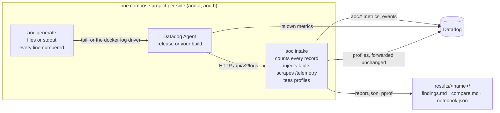
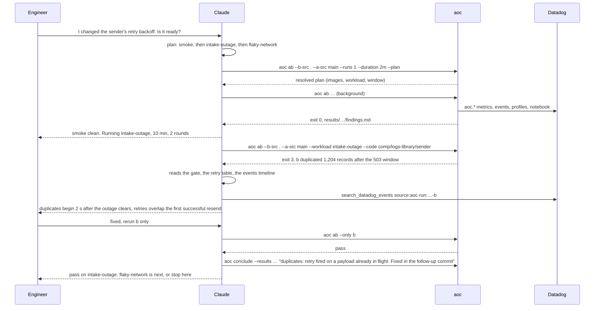

# agent_of_chaos

`aoc` puts a Datadog Agent in a hard logs situation, counts every record
that comes out the other end, and tells you what was lost, duplicated,
slowed down or made more expensive. It runs on a laptop in Docker. It is
built to be driven by Claude Code: you describe what you changed or what
you are worried about, Claude picks the workload, runs it, reads the
brief and proposes the next run. Every run is one command line you can
also type yourself.

## What it is

Three pieces, one compose project per agent under test:

- **A log generator** that writes realistic lines to files or stdout.
  Every line carries a sequence marker, so delivery can be accounted for
  exactly rather than estimated from rates.
- **A fake intake** that stands in for Datadog's logs endpoint. It counts
  every record, injects faults on demand (latency, dropped connections,
  429s and 5xx, full outages, a slow uplink), scrapes the agent's
  telemetry, and copies the agent's continuous-profiler uploads before
  forwarding them to Datadog.
- **A reporter** that turns the run into `report.md`, and for an A/B test
  into `findings.md`: a verdict, the four signals, and the profile
  functions that moved, with file and line.



An A/B test runs two of these stacks side by side on the same host, so
both agents see the same moment of the machine. Datadog is the system of
record: `aoc.*` metrics, `source:aoc` events, the agent's own profiles
and a notebook per test, all tagged `experiment:<name> variant:a|b`.
`results/` is the working copy.

## Why you would use it

The agent's CI has an end-to-end suite and single-machine performance
tests. They are the record of truth for a release, and they answer
"did this commit regress the benchmark". `aoc` is for the questions that
come up before you push and that CI is not shaped to answer:

- **Does my working tree lose or duplicate records under a specific
  failure?** A 45 s intake outage, copytruncate rotation at 128 KiB,
  writers that crash mid-line. The ledger is exact, so "0 lost, 3
  duplicated" is a fact, not a sampling artifact.
- **What does this flag or setting cost, and what does it buy?** Same
  build on both sides, the flag on one. CPU, memory, saturation, wire
  bytes and the feature's own counters on one page.
- **Where is the knee on this machine?** Raise one knob one run at a
  time until delivery drops or a component saturates.
- **Which function moved?** The profiler runs on both sides. The brief
  diffs CPU, heap and allocations function by function and marks which
  files changed between the two builds.

A quick look is about five minutes. A decision (ten minutes, two rounds,
both sides at once) is about half an hour. Builds from your checkout
take about a minute each after the first.

## Getting started

You need Docker, Go 1.25 or later, and a Datadog API key so metrics,
profiles and notebooks land in your org. An app key lets `aoc` create the
notebook itself.

```bash
cp .env.example .env     # DD_API_KEY, optionally DD_APP_KEY
make build               # ./bin/aoc
```

A first run by hand, five minutes, one agent, the steady workload:

```bash
./bin/aoc run --profile baseline --duration 2m --name first-look
cat results/first-look/report.md
```

A first A/B, the release against the agent's master image:

```bash
./bin/aoc ab --b datadog/agent-dev:master-py3 --runs 1 --duration 2m --name smoke \
  --focus "smoke: release vs master"
cat results/smoke/findings.md
```

Or start Claude Code in this directory and state the goal:

```text
I changed the sender's retry backoff in ../datadog-agent. Is it ready?
```

Claude builds an image from your checkout, plans two to four runs, runs
them one at a time in the background, reads each brief and tells you what
moved and what it would run next. `docs/sessions.md` shows six sessions
turn by turn.

## The workloads

A workload is a profile in [profiles/](profiles/): the generators, the
intake's fault timeline, any agent settings, and the measured window.
Each one is built to stress a different part of the pipeline, and every
number in it can be changed on the command line (next section).
`./bin/aoc profiles` prints this list with the resolved numbers.

| workload | stresses | shape | intake faults | what to watch |
|---|---|---|---|---|
| `baseline` | everything, lightly; the reference point | 8 plain + 8 JSON file streams, 10k lines/s total, 5 % stack traces, 2 MiB rotation, 3 min | none | the four signals; a change that shows here shows everywhere |
| `high-throughput` | the file tailer at its limit | 24 plain streams, 100k lines/s, 4 MiB rotation keeping 3, 8 % stack traces, 6 % oversized 4 KiB lines, 3 min | none | delivery ratio, saturation, CPU, end-to-end latency; raise `rate` until something gives |
| `deterministic-bytes` | the whole pipeline's maximum on identical input | 8 streams flat out, seeded content, a fixed 2,000,000 records, 4 MiB rotation | none | throughput is the agent's maximum; CPU seconds per 1M logs and wire bytes are directly comparable. No latency: timestamps are synthetic |
| `rotation-churn` | rotation races in the tailer | 16 streams, 20k lines/s, 128 KiB files kept 2 deep; copytruncate on the plain half, rename on the JSON half, 3 min | none | lost records per stream; the streams table says which rotation mode lost |
| `chaos-restarts` | the tailer's file-handle lifecycle | 24 streams, 16k lines/s, each stream crashes 3 times a minute and restarts after 5 s, 4 min | none | lost and duplicated records around restarts, open file handles |
| `multiline-heavy` | the decoder's multiline aggregation | 12 plain streams, 8k lines/s, 35 % of records followed by a Python, Java or Go stack trace; auto multiline detection off, 3 min | none | orphan continuation lines, "multiline received / written", CPU; flip `DD_LOGS_CONFIG_AUTO_MULTI_LINE_DETECTION` |
| `high-compression` | the encoder and compression | 12 plain + 12 JSON streams, 30k lines/s, 20 % stack traces, 12 % oversized lines, 256 KiB rotation, 3 min | none | wire bytes per second, compression ratio, CPU; compare `DD_LOGS_CONFIG_COMPRESSION_KIND=gzip` and `zstd` |
| `incident-scenario` | how the pipeline absorbs a step change | the built-in incident scenario at 10× speed: calm, a sudden 14-stream spike with heavy traces and bursts, a slow recovery, 5 min | none | latency and saturation through the spike, buffering, recovery |
| `intake-outage` | the sender's buffering, retry and backoff | the `baseline` streams, 4 min | 503 to every request from 45 s to 90 s, then 20 % 429s from 150 s to 180 s | recovery time, retries and responses by status, lost or duplicated on the way back |
| `flaky-network` | exactly-once delivery on a bad uplink | the `baseline` streams, 4 min | from 30 s to 3 min: 10 % of requests get no response, every response delayed 300 ± 200 ms, bodies read at 500 kB/s | duplicates first, then latency and in-flight payloads |
| `tag-heavy-fleet` | tag volume in the processor and the docker launcher | 15 containers logging to stdout at 500 lines/s each, collected by the docker log driver; about 40 tags per line from 20 docker labels plus 15 host tags, 3 min | none | tag bytes per log, CPU and allocations in the processor; compare with and without `DD_LOGS_CONFIG_TAG_FILTERS` |

Which one to reach for, by the code you touched:

| you touched | start with | then |
|---|---|---|
| the tailer, rotation, file handles | `rotation-churn` | `chaos-restarts` |
| the decoder, multiline, framing | `multiline-heavy` | `high-throughput` |
| the processor, tags, encoding | `baseline` | `tag-heavy-fleet` |
| the sender, batching, retry, backoff | `intake-outage` | `flaky-network` |
| compression | `high-compression` with `--watch "received wire B/s"` | `deterministic-bytes` |
| container logs, autodiscovery | `tag-heavy-fleet --set app.replicas=30` | |
| raw throughput, a version bump | `deterministic-bytes` | `baseline` |

### Tuning a workload

Nothing in a profile is fixed. The command line changes any of it, and
the profile as it actually ran (every default and override applied) is
written to `results/<name>/profile.yaml`, so a run can be repeated from
one file.

| to change | flag | examples |
|---|---|---|
| any generator setting, for all generators or one | `--set KEY=V`, `--set <gen>.KEY=V` | `--set rate=20000`, `--set json.streams=16`, `--set multiline-rate=0.3`, `--set plain.rotate-mode=truncate`, `--set app.replicas=30` |
| the intake, for the whole window | `--fault K=V,…` | `--fault latency_ms=500,jitter_ms=200`, `--fault drop_rate=0.05`, `--fault error_rate=0.2,error_status=429`, `--fault outage=true`, `--fault read_bps=500000` |
| an agent setting on both sides | `--env DD_…=…` | `--env DD_LOGS_CONFIG_COMPRESSION_KIND=gzip` |
| an agent setting on the candidate only | `--b-env DD_…=…` | `--b-env DD_LOGS_CONFIG_PIPELINES=16` |
| the window and the rounds | `--duration`, `--runs` | `--runs 1 --duration 2m` for a look, `--runs 3` when a delta sits on its threshold |
| which packages the profile diff puts first | `--code PKG` | `--code comp/logs-library/sender` |
| a metric promoted to the headline | `--watch METRIC` | `--watch "tag bytes per log"` |

The `--set` keys are the `aoc generate` flags without the dashes
(`streams`, `rate`, `rotate-bytes`, `rotate-keep`, `rotate-mode`,
`multiline-rate`, `wide-line-rate`, `wide-line-bytes`, `mode` and that
mode's flags, and so on), plus `format`, `output` and `replicas`. An
unknown key is an error before anything starts. `--plan` prints the
resolved workload and exits, which is the way to check an override.

A new profile file is only needed when a shape is worth keeping or when
faults have to change during the window (a `faults:` timeline). Copy the
closest one and edit it; [profiles/README.md](profiles/README.md) has the
format. [aoc.yaml](aoc.yaml) holds what every test shares: the control
image, the default workload, the window, the rounds and the per-signal
thresholds. It is settings, never a test.

## Reading the results

### A single run

`results/<name>/report.md`, delivery section first. The ledger is exact:

- **lost**: generated, never received after the drain. With faults on,
  the report says whether they may still be buffered in the agent rather
  than gone.
- **duplicated**: received more than once. Almost always a retry of a
  payload the intake had already counted.
- **orphaned**: a continuation line that arrived without its first line.
  A multiline aggregation miss.
- **truncated**: a record cut short. Usually an oversized line.
- **out of order**: reported, not a failure; expected across many
  streams.

After that: end-to-end latency percentiles, throughput, retries and
responses by HTTP status, the agent's CPU, RSS and Go heap, component
utilization, and the top messages from the agent log.

### An A/B test

`results/<name>/findings.md` is the brief. It opens with a verdict line,
then one section per signal:

| | what decides it | fails the run |
|---|---|---|
| **delivery gate** | records lost, duplicated, orphaned or truncated on the candidate | yes, exit 3 |
| **throughput** | received logs per second. A paced workload holds its rate, so this only moves when the candidate falls short of what was generated. Under `deterministic-bytes` it is the agent's maximum | no |
| **saturation** | the busiest component's `logs_component_utilization` ratio | no |
| **cpu** | core agent process CPU average, CPU seconds per million logs | no |
| **memory** | core agent RSS max, container anonymous memory average, Go heap in use | no |

Each signal has a threshold in `aoc.yaml` (5 % for throughput, CPU and
memory, 10 % for saturation by default). Under a signal that crossed it
comes the evidence: memory by process and by cgroup, utilization by
component, the CPU, heap and allocation profiles diffed function by
function, each mover at `file:line`, and whether that file changed
between the two builds. Every other metric (latency, tags, compression,
wire bytes, goroutines, log warnings) is in `compare.md` beside it.

How to read what comes back:

| you see | it means | do |
|---|---|---|
| exit 3, the gate failed on b | the candidate lost or duplicated records | look at the streams table (which stream, where relative to rotations) and the retry table; this is a finding, not a harness error |
| a signal crossed its threshold on b, a was flat | the build | the profile diff under that signal names the function; the code table says if its file changed |
| both sides moved the same way | the host or the workload, not the change | rerun, or ignore; the brief marks these separately |
| a delta within a point of its threshold | not decided | another round with `--runs 3`, not an investigation |
| clean | nothing crossed | the next workload for the area you touched, then conclude |
| lost records after a run with faults | retries may still be in flight | the report says so; a longer `drain:` settles it |

A real one, from the tag-filter session in `docs/sessions.md`: same
build on both sides, every tag key excluded on the candidate, four times
the baseline rate. Core agent CPU went from 34.5 % to 30.9 %, Go heap in
use from 104.9 MB to 88.2 MB, wire bytes fell 4 % even though the
compression ratio dropped from 21.7× to 17.4×, and the brief named the
filter's own cost: a per-message `make([]string)` in
`tagfilter.(*Scoped).Keep` at 1.7 MB/s of allocations.

### Where things are

| want | read | never |
|---|---|---|
| a run's outcome | `results/<name>/report.md` | |
| the verdict and why | `results/<name>/findings.md` | `report.json` whole, `timeseries.csv`, `*.pprof` |
| the signals or the gate alone | `jq '.signals' results/<name>/findings.json`, `jq '.gate' …` | |
| every metric | `results/<name>/compare.md` | |
| the agent's log | `grep -c '| ERROR |' results/<name>/<side>/agent.log` | `cat agent.log` |
| what a built side came from | `jq '.sides[].build' results/<name>/ab.json` | |
| the workload as it ran | `results/<name>/<side>/profile.yaml` | |
| charts and flame graphs | the notebook URL in `ab.json`, or the Datadog MCP | hand-built profiler URLs |

When a signal regressed, the brief's `Next` line names the Datadog MCP
call to make. Two calls per regressed signal is the budget. Record what it
turned out to be with `aoc conclude`; the text lands on top of the
notebook, as an event next to the run's metrics, and in `findings.md`.

## Working with Claude

The repository ships four skills in `.claude/skills/`. `/aoc` takes a
goal to a conclusion; the others are what it delegates to, and each can
be asked for directly.

| skill | fires on | does |
|---|---|---|
| `aoc` | "I'm working on …, help me test it", "is my branch ready", "keep going" | plans two to four runs, runs them in order, reads each brief, decides the next one, closes with `aoc conclude` |
| `ab-test` | "test my branch", "did master regress", "flag on vs off" | one `aoc ab` line from what you changed; runs it; reports the verdict |
| `experiment` | "what happens to the agent when …", "find the knee" | one `aoc run` line from a situation, or a sweep of one knob one run at a time |
| `investigate` | "why did memory go up in results/x" | from the brief to a named function, with a bounded number of Datadog MCP calls, then `aoc conclude` |



Prompts that map onto one command each:

> I changed the tailer's rotation handling on my branch. Does it lose
> anything under copytruncate?

```bash
./bin/aoc ab --b-src . --a-src main --workload rotation-churn \
  --code pkg/logs/tailers --code pkg/logs/launchers \
  --focus "tailer rotation handling: anything lost under copytruncate?"
```

> Is auto multiline detection worth its CPU when a third of the lines are
> stack traces? Same build, flag on versus off.

```bash
./bin/aoc ab --b datadog/agent:7 --workload multiline-heavy \
  --b-env DD_LOGS_CONFIG_AUTO_MULTI_LINE_DETECTION=true \
  --focus "auto multiline detection at 35% stack traces: cost and benefit"
```

> Where is the knee for the file tailer on this laptop?

```bash
./bin/aoc run --profile high-throughput --set rate=100000 --duration 2m --name knee-100k
./bin/aoc run --profile high-throughput --set rate=150000 --duration 2m --name knee-150k
./bin/aoc compare results/knee-100k results/knee-150k
```

> Thirty containers on stdout with forty tags each, and the intake reads
> at 500 kB/s. Does the agent keep up?

```bash
./bin/aoc run --profile tag-heavy-fleet --set app.replicas=30 --fault read_bps=500000 --name fleet-slow-uplink
```

## Commands

```text
aoc ab        --b IMAGE | --b-src . [--a IMAGE | --a-src REF] [--workload NAME|PATH]
              [--set K=V] [--fault K=V] [--env K=V] [--b-env K=V] [--code PKG] [--watch METRIC]
              [--focus TEXT] [--runs N] [--duration D] [--name N] [--plan] [--only b] [--compare-only]
aoc run       --profile NAME|PATH [--set K=V] [--fault K=V] [--env K=V] [--agent-image I] [--name N] [--plan]
aoc build     [--src .|REF] [--base IMAGE]      an agent image from the checkout: aoc/agent-dev:<branch>
aoc conclude  --results results/<name> "text"   record a conclusion (event, notebook, findings.md)
aoc profiles  [show NAME]                       the workloads; one with its defaults filled in
aoc compare   results/x results/y               diff single runs
aoc notebook  --results results/x               (re)create a Datadog notebook
aoc generate | intake | ship | report           the pieces, run by hand
```

`--b-src .` builds the image under test from the agent checkout
(`source:` in `aoc.yaml`, `DATADOG_AGENT_SRC`, else `../datadog-agent`),
uncommitted changes included. `--a-src main` builds the control the same
way so only the branch differs. Every command takes `-h`. A run takes
warmup + window + drain + about two minutes; `aoc ab` runs both sides at
once. Exit 3 means the delivery gate failed.

## Docs

| | |
|---|---|
| [docs/sessions.md](docs/sessions.md) | six sessions turn by turn: what was asked, what ran, what came back, what was proposed next |
| [AGENTS.md](AGENTS.md) | the agent-facing guide: how to lead the loop, what to read and what never to |
| [docs/measurements.md](docs/measurements.md) | what every number means and where it misleads |
| [docs/datadog.md](docs/datadog.md) | what lands in Datadog: metrics, events, profiles, notebooks |
| [docs/reference.md](docs/reference.md) | the pieces by hand, faults on a live intake, building from the checkout, gotchas |
| [profiles/README.md](profiles/README.md) | the workload file format |
| [aoc.example.yaml](aoc.example.yaml) | every shared setting with its default |
