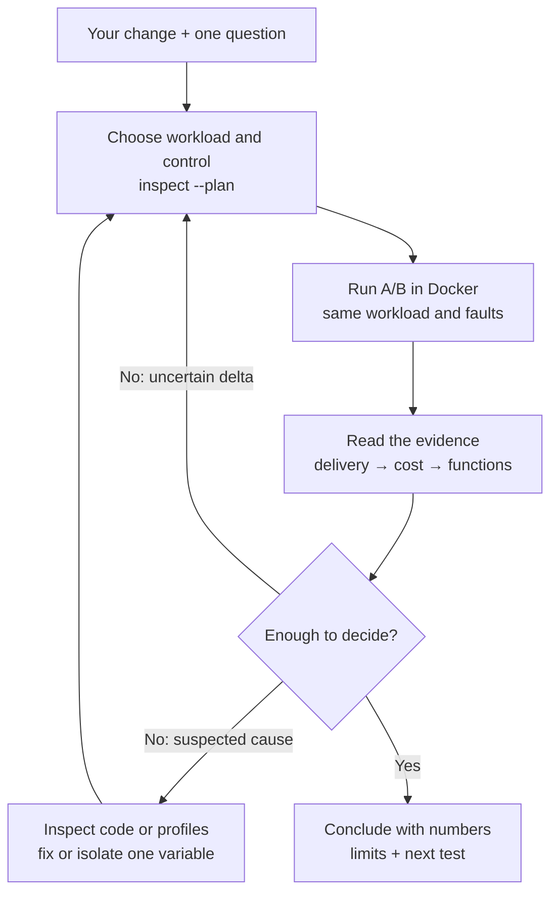

# agent_of_chaos (`aoc`)

**Fast feedback for local changes to the Datadog Agent logs pipeline.**
Put your working tree and a control build through the same workload and intake
faults in Docker. Get delivery counts, CPU/memory deltas, and profile functions
to investigate—before deciding what to change or test next.

Use it when your question is specific: **“Did my retry change introduce duplicates
after an outage?”**, **“What does this tag filter save at 4× load?”**, or
**“Does my tailer change survive copytruncate?”** Claude Code can lead the loop;
every experiment is also a CLI command you can run yourself.

## What you get

| Engineer's question | Evidence `aoc` provides | Decision it helps you make |
|---|---|---|
| Did records survive? | Sequence-marked records reconciled at a fake intake; missing, duplicate, orphan and truncation counts | Investigate delivery before accepting a resource improvement |
| What did my change cost? | A/B CPU, memory, throughput and component utilization; medians across rounds | Keep the change, adjust it, or repeat a borderline result |
| Where should I look? | CPU/heap/allocation profile differences, functions and source locations when captured | Read the relevant code and test a cause |
| Can I explain the result? | Reproducible workload, build provenance, local brief, Datadog telemetry, and an MCP-authored notebook | Share the evidence, its limits, and one next experiment |

A quick look uses a **2-minute measurement window**, roughly **5 minutes wall
time after images/builds are ready**. The default A/B uses 10-minute windows
and two rounds, roughly half an hour plus builds. First-time downloads and builds
can take substantially longer. These are development signals on this host and
workload; a clean result does not establish release readiness.

## Why use this alongside SMP?

SMP already supports local runs. Its Agent regression experiments detect
performance changes beyond random variation and include quality gates;
see the [Agent regression documentation](https://github.com/DataDog/datadog-agent/blob/main/test/regression/README.md).
Local execution alone is not `aoc`'s distinction.

| When you need… | Reach for… |
|---|---|
| Evidence against a maintained performance benchmark or release quality gate | SMP and the Agent's CI suites |
| An answer about an uncommitted logs change under a workload/failure you are shaping now | `aoc`: build the tree, set the shape, inspect delivery and cost, edit, rerun |
| Stronger evidence after a useful local finding | Reproduce it in the relevant maintained test; carry the `aoc` workload, identities and conclusion into the review |

The value is less time from **“I changed this”** to **“here is what moved,
where I would look, and what I would try next.”** The comparison uses configured
thresholds and a small number of rounds, not statistical significance tests.

## The development loop



The fake intake replaces the logs endpoint, counts the generated records and
injects faults. Each side has its own generator, Agent and intake. Both stacks
share the host, so resource contention can affect the comparison. Metrics,
events and profiles go to Datadog; local results let you inspect the evidence
without waiting for a notebook. [Architecture and commands](docs/reference.md).

## First answer from your checkout

You need Docker with Compose, Go 1.25+, and a Datadog API key for telemetry.
From **this repository**, with the Agent checkout at `../datadog-agent`:

```bash
cp .env.example .env                 # set DD_API_KEY locally; never commit it
make build
# If the Agent checkout is elsewhere, set DATADOG_AGENT_SRC in .env.
```

In Claude Code, start here and ask:

> I changed the sender's retry backoff in ../datadog-agent. Compare my working
> tree with main under intake-outage. Start with a quick look, tell me what
> moved, and propose the next run. Publish the conclusion through Datadog MCP.

Or run the same first experiment yourself. `.` means the **configured Agent
checkout**, not this harness. `main` must exist in that checkout; use the base
ref relevant to your change.

```bash
./bin/aoc ab --b-src . --a-src main --workload intake-outage \
  --runs 1 --duration 2m --name retry-smoke \
  --code comp/logs-library/sender \
  --focus "Does my retry change preserve delivery after a 503 outage?" --plan

# Inspect the checkout, dirty files, control and fault timeline. Then run:
mkdir -p results
./bin/aoc ab --b-src . --a-src main --workload intake-outage \
  --runs 1 --duration 2m --name retry-smoke \
  --code comp/logs-library/sender \
  --focus "Does my retry change preserve delivery after a 503 outage?" \
  > results/retry-smoke.log 2>&1 &
run_pid=$!
wait "$run_pid"
cat results/retry-smoke/findings.md
```

This 2-minute smoke reaches the 503 outage/recovery; it **does not reach the
429 phase at 150 seconds**. For the full scenario, repeat with a fresh name and
omit `--runs 1 --duration 2m` to use the configured decision window and rounds.
Run one experiment at a time. Exit `3` is a delivery finding, not a harness crash;
exit `0` still requires reading the performance signals. Other failures: inspect
`tail -40 results/retry-smoke.log` (or the named build log).

Already have an image? Replace `--b-src . --a-src main` with `--b IMAGE` to
compare against the configured release. Testing a flag? Set **both** `--a IMAGE`
and `--b IMAGE` to the same image, then add `--b-env KEY=VALUE`.

## Shape the question, then read the answer

| Code or concern | First workload | Useful next shape |
|---|---|---|
| Tailer, rotation, file discovery | `rotation-churn` | `chaos-restarts` |
| Decoder, multiline | `multiline-heavy` | `high-throughput` |
| Sender, retries, batching | `intake-outage` | `flaky-network` |
| Processor, tags | `baseline` | `tag-heavy-fleet` |
| Compression | `high-compression` | `deterministic-bytes` for repeatable bytes |

Use `--set rate=20000` to set **each generator's** rate (two generators means
40k total), `--fault latency_ms=500` for a whole-window fault, `--b-env` for the
candidate's setting, and `--watch "e2e latency p99"` to surface a metric relevant
to the question. `--fault` replaces the profile's timeline. `--watch` adds context,
not a new pass/fail threshold. [All workloads and overrides](docs/workloads.md).

Read `results/<name>/findings.md` first:

- **Delivery gate:** missing, duplicate, orphaned or truncated records on B fail
  the A/B. Missing after drain can mean still buffered; extend the drain to check.
- **Cost:** throughput, saturation, CPU and memory against configured thresholds.
  A paced input cannot demonstrate maximum capacity. Fixed-budget deterministic
  input can finish early; its window average is not automatically peak throughput.
- **Explanation:** profiles identify leads. A changed function, shared failure,
  or upward heap line alone does not prove causality. Missing profiles or
  underfed generators limit what you can conclude.

Near a threshold, repeat with `--runs 3`. A shared failure makes attribution
uncertain; it does not erase the candidate's failed delivery gate. After a fix,
`--only b` is a fast check using the saved configuration:

```bash
./bin/aoc ab --config results/retry-smoke/aoc.yaml --only b
```

That reuses an older control. Rerun both sides for a final comparison if host,
image or workload conditions changed. [Metric definitions and limits](docs/measurements.md).

## A concise conclusion, shared through MCP

Claude reads the measured brief, investigates only what needs explanation, and
writes: **answer → deciding numbers → evidence/hypothesis → limits → next test**.
Keep the analysis short enough to review in one screen. For an A/B:

```bash
./bin/aoc conclude --results results/retry-smoke --verdict inconclusive \
  "Record the actual counts, deltas, limitation and next experiment here."
```

This saves `conclusion.md` and posts a Datadog event when configured. It does not
publish or edit a notebook. `notebook.md` indexes reusable charts; Claude selects
the useful evidence and authors the narrative through Datadog MCP. `DD_APP_KEY`
is no longer used by `aoc`; `DD_API_KEY` is still needed for telemetry. Without
MCP, the local result and conclusion remain usable and the notebook is reported
as unpublished. [MCP setup, authoring and URL recording](docs/notebooks.md).

## Go deeper

- [Example sessions](docs/sessions.md): one historical result and five illustrative loops.
- [Agent instructions](AGENTS.md): skill routing, experiment discipline, bounded investigation.
- [Datadog data](docs/datadog.md): metrics, tags, events and profile provenance.
- [Reference](docs/reference.md): commands, architecture, faults, builds and troubleshooting.
- [Workload format](profiles/README.md) and [shared settings](aoc.example.yaml).
- [Product review](docs/product-review.md): critique, changes and remaining gaps.
