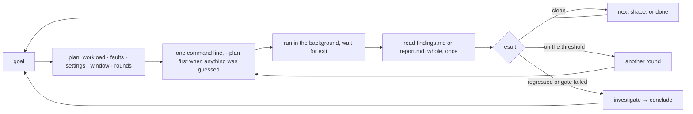

# Sessions

Seven sessions with Claude Code in this repository, turn by turn: what the
engineer said, what Claude decided about the environment and why, the
command it ran, what came back, and what it proposed next. Sessions 1 and
7 are real runs from this checkout (`results/dev-filter-all-4x` and
`results/agentic-smoke`); the numbers in the others are illustrative and
show the shape of the exchange, not a measurement. Sessions 1 to 6 predate
the web UI, so their runs show the bare `./bin/aoc` line; today Claude
launches the same line as `ui/bin/aoc-ui run -- …` (session 7).

Each session follows the same loop:



## 1. Is the tag filter paying for itself at 4× volume? (real)

> **Engineer:** Same tag-filter build on both sides, filter every tag key
> the logs carry on one of them, four times the baseline rate. Is the
> filter a net win or does the work of filtering eat what it saves?

**Claude's plan.** The question is about one flag, so the same image goes
on both sides and only `--b-env` differs. Four times baseline is
`--set rate=20000` on each of the two file generators. A flag test on a
processor-side feature is judged on CPU, memory and bytes, so `--watch
"tag bytes per log"` goes on the headline and `--code
comp/logs-library/tagfilter` puts the filter's own functions first in the
profile tables. The profiler period is shortened to 30 s so a 5 min
window yields ten periods per side.

```bash
./bin/aoc ab --a datadog/agent-dev:log-tag-filtering-9e35a50b-full \
  --b datadog/agent-dev:log-tag-filtering-9e35a50b-full \
  --workload baseline --set rate=20000 --duration 5m \
  --b-env 'DD_LOGS_CONFIG_TAG_FILTERS={"exclude":["dirname:*","filename:*","log_format:*","project:*","multiline:*","container_id:*","container_name:*","docker_image:*","image_id:*","image_name:*","image_tag:*","short_image:*"]}' \
  --env DD_INTERNAL_PROFILING_PERIOD=30s --env DD_INTERNAL_PROFILING_CPU_DURATION=30s \
  --watch "tag bytes per log" --code comp/logs-library/tagfilter \
  --name dev-filter-all-4x --focus "tag filter, every tag key excluded, 4x volume: does it pay for itself?"
```

**What came back** (`results/dev-filter-all-4x/findings.md`):

| metric | nofilter | filterall | Δ |
|---|---|---|---|
| core agent process CPU avg | 34.5 % | 30.9 % | −10.4 % |
| CPU seconds per 1M logs | 9.21 | 8.25 | −10.4 % |
| core agent Go heap in use | 104.9 MB | 88.2 MB | −15.9 % |
| tag bytes per log | 118.6 B | 0.0 B | −100 % |
| received wire B/s | 903.9 kB/s | 867.5 kB/s | −4.0 % |
| compression ratio | 21.65× | 17.42× | −19.5 % |
| out of order | 5,395 | 4,178 | −22.6 % |

Delivery 99.97 % on both sides, 0 duplicates, about 3.7k missing per side.
**The delivery gate fails.** Matching counts on both sides point at the
workload rather than the build, but do not name the cause; the stream gaps
in each side's `report.md` would.

**Claude's reading.** The compression ratio fell because the bytes removed
were the most repetitive ones; wire bytes still went down, so it is not a
regression. The allocation diff names the filter's own cost:
`tagfilter.(*Scoped).Keep` at 1.7 MB/s from a per-message `make([]string)`
at `comp/logs-library/tagfilter/tagfilter.go:364`, four times the
434 kB/s measured at 1× and so linear in log rate. Compacting the slice
in place would remove it.

```bash
./bin/aoc conclude --results results/dev-filter-all-4x --verdict inconclusive \
  "Delivery gate failed: about 3.7k missing on each side; shared-loss attribution remains unconfirmed. The filter stripped every tag (118.6 → 0 B/log) and paid for itself: core agent CPU 34.5 → 30.9 %, heap in use 104.9 → 88.2 MB, wire bytes −4 % despite compression 21.7× → 17.4×. Its own cost is tagfilter.(*Scoped).Keep at 1.7 MB/s of allocations from the per-message make([]string) at tagfilter.go:364; compacting in place would remove it."
```

**Next, proposed.** Rerun both sides with more rotation retention and a
longer drain to isolate the shared missing records. If delivery is clean,
`tag-heavy-fleet` checks the same tradeoff with container tags.

## 2. I changed the sender's retry backoff. Is it ready to push?

> **Engineer:** My checkout changes how the sender backs off after a 5xx.
> I want to know it's safe before I open the PR.

**Claude's plan.** "Safe" for a sender change means the delivery gate under
an intake that misbehaves. Three runs in order, each a decision point:

1. a smoke of the build: `--runs 1 --duration 2m` on `baseline`, to prove
   the checkout compiles into an image and both stacks come up;
2. `intake-outage`: a 45 s 503 outage then 20 % 429s, the workload whose
   fault timeline is the backoff's reason to exist;
3. `flaky-network` if 2 is clean: dropped connections and latency, where
   retry logic duplicates.

Both sides built from the checkout (`--b-src . --a-src main`) so only the
branch differs; `--code comp/logs-library/sender` so the sender's
functions lead the profile tables.

```bash
./bin/aoc ab --b-src . --a-src main --runs 1 --duration 2m --plan
```

The plan shows the checkout, the branch, the commit and that 3 files are
uncommitted; Claude checks that against what the engineer said they
changed, then runs the smoke. It passes.

```bash
./bin/aoc ab --b-src . --a-src main --workload intake-outage --code comp/logs-library/sender \
  --focus "sender backoff after 5xx: safe under an outage and throttling?"
```

**What came back.** Exit 3.

```text
fail: b duplicated 1,204 records
  lost 0 vs 0 · duplicates 0 vs 1,204 · out of order 312 vs 2,961
```

**Claude's reading.** The gate section's retry table shows the candidate
made 41 more successful resends than the control in the 30 s after the
outage cleared. One MCP call, `search_datadog_events` with
`source:aoc run:…-b`, places the injected faults against the duplicates:
they begin 2 s after the 503 window clears. The brief's code table
marks `(*destination).sendAndRetry` as changed in b. Reading that window
of the diff: the new backoff resets its timer on every response, so a
payload whose first retry is in flight is retried again when the intake
comes back, and both land.

> **Claude:** The duplicates start 2 s after the outage clears and track
> the retry count. In the new `sendAndRetry` the backoff timer resets on
> each response, so a payload already in flight is resent when the first
> 202 comes back. Lost is 0 on both sides, so the backoff itself holds;
> this is the retry firing twice.

> **Engineer:** Fixed. Rerun just my side.

```bash
./bin/aoc ab --config results/retry-backoff-dirty-intake-outage/aoc.yaml --only b
```

The saved config still carries `--b-src .`, so this rebuilds b from the
tree as it now is, reruns it and reuses a's results. Pass: 0 duplicates, out of order 312 vs 340.

```bash
./bin/aoc conclude --results results/retry-backoff-dirty-intake-outage --verdict pass \
  "First run duplicated 1,204 records: the new backoff reset on every response and resent a payload already in flight when the outage cleared. Fixed in the working tree; rerun of b is clean (0 lost, 0 duplicated, out of order 340 vs 312)."
```

**Next, proposed.** `flaky-network`, the third run in the plan.

## 3. Is auto multiline detection worth its CPU?

> **Engineer:** We're thinking of turning
> `logs_config.auto_multi_line_detection` on by default. On a workload
> that is a third stack traces, what does it cost and what does it buy?

**Claude's plan.** The release on both sides, the flag on b only.
`multiline-heavy` carries 35 % Python, Java and Go stack traces at
8,000 lines/s. The benefit shows in two counters the brief carries under
the gate: orphan continuation lines (a stack-trace line delivered as its
own log) and multiline received versus written. The cost is the cpu
signal. The config's 10 min window and 2 rounds stay, since the decision
is about a default.

```bash
./bin/aoc ab --b datadog/agent:7 --workload multiline-heavy \
  --b-env DD_LOGS_CONFIG_AUTO_MULTI_LINE_DETECTION=true \
  --code pkg/logs/internal/decoder \
  --focus "auto multiline detection on by default: cost and benefit at 35% stack traces"
```

**What came back.** Regression on cpu, by a margin that is the point of
the test.

| signal | metric | a | b | Δ | threshold |
|---|---|---|---|---|---|
| cpu | core agent process CPU avg | 18.2 % | 21.9 % | +20.3 % | 5 % |
| cpu | CPU seconds per 1M logs | 22.7 | 27.4 | +20.7 % | 5 % |
| memory | core agent Go heap in use | 71 MB | 74 MB | +4.2 % | 5 % |

Gate: pass. Orphans 41,880 → 0; multiline received 84,012 → 83,990 against
84,100 written.

**Claude's reading.** The cost is a fifth of the core agent's CPU at this
rate, all of it in the decoder: the CPU diff puts
`preprocessor.(*Tokenizer).emitToken` and the aggregator's regex match at
the top, both in scope. The benefit is every orphan gone. Both sides of
the trade are on the page.

> **Claude:** +20 % CPU on the core agent, entirely in the tokenizer and
> the aggregator, and it buys 100 % of the orphans. Whether that is the
> right default depends on how common 35 % stack traces are; at the
> baseline's 5 % the cost will be a fraction of this. Want the same test
> on `baseline` so the default's cost is measured on the common case?

## 4. Where is the knee of the file tailer on this laptop?

> **Engineer:** How fast can the tailer go here before it starts losing
> or saturating? I want a number for the design doc.

**Claude's plan.** A sweep, one `aoc run` per rate on `high-throughput`,
2 min windows, bounded to four steps. After each run it reads delivery
and the busiest component's utilization, and stops when either gives:
delivery under 99.9 %, or a component at 1.0 while the generators still
hold their rate. The release is the agent.

```bash
./bin/aoc run --profile high-throughput --set rate=100000 --duration 2m --name knee-100k
./bin/aoc run --profile high-throughput --set rate=150000 --duration 2m --name knee-150k
./bin/aoc run --profile high-throughput --set rate=200000 --duration 2m --name knee-200k
./bin/aoc compare results/knee-100k results/knee-150k results/knee-200k
```

| rate | delivery | busiest component | core agent CPU |
|---|---|---|---|
| 100k/s | 100 % | processor 0.62 | 71 % |
| 150k/s | 100 % | processor 0.91 | 104 % |
| 200k/s | 99.2 % | processor 1.00 | 118 % |

**Claude's reading.** The processor saturates between 150k and 200k lines
per second on this host; delivery drops once it is pinned, and the loss
is the generator outrunning the tailer, not a bug. The number for the
design doc is the saturation point, not the loss.

> **Claude:** The knee is between 150k and 200k lines/s on this laptop,
> and the processor is the component that pins first. One more run at
> 175k would narrow it; or, if the question is really about the tailer,
> `--set streams=48` keeps the rate and doubles the files so the file
> readers, not the processor, are what is pushed.

## 5. Does my rotation change lose anything under copytruncate?

> **Engineer:** My branch changes how the tailer handles a file that was
> truncated under it. Does it drop lines during rotation?

**Claude's plan.** `rotation-churn`: 128 KiB files, copytruncate on the
plain-text half and rename on the JSON half, 10,000 lines/s each, so
every missing record is a rotation race and the streams table says which
mode lost it. Both sides from the checkout, `--code pkg/logs/tailers`.

```bash
./bin/aoc ab --b-src . --a-src main --workload rotation-churn --code pkg/logs/tailers \
  --focus "truncated-file handling: does it drop lines during rotation?"
```

**What came back.** Exit 3.

```text
fail: b lost 2,318 records (a: 0)
```

**Claude's reading.** From the candidate's `report.md`, the streams table:
every gap is on a plain-text stream (copytruncate), none on JSON (rename),
and each gap is a few hundred records immediately after a rotation. The
JSON half is clean, so file discovery is fine; the truncate path is what
changed and what loses.

```bash
jq '.streams[] | select(.missing>0) | {gen,stream,missing,gaps}' results/<name>/b/report.json
```

> **Claude:** Every gap is on a copytruncate stream, right after a
> rotation: 2,318 records across 8 streams, 0 on the rename half. The
> candidate's tailer reads from the old offset after the truncate until
> the next scan, so the lines written between the truncate and the scan
> are skipped. `(*Tailer).read` is marked changed in the code table. I'd
> look at how the new code decides the file shrank.

## 6. Memory went up 8 % in results/sender-batching-flaky-network. Where?

> **Engineer:** The A/B I ran last night says memory regressed. Where is
> it?

**Claude's plan.** The `investigate` skill. Read the brief whole, once.
The memory section's "where the memory is" table settles the first
question with no MCP call: which of the three memory metrics moved, and
whether it is the Go heap, non-Go memory in the core agent, another
process in the container, or page cache.

| metric | a | b | Δ |
|---|---|---|---|
| core agent RSS max | 262 MB | 284 MB | +8.4 % |
| agent container anon mem avg | 221 MB | 239 MB | +8.1 % |
| core agent Go heap in use | 84 MB | 101 MB | +20.2 % |

Core RSS up, heap up: the heap-in-use diff names the function.
`(*batchStrategy).flush` holds +14 MB live, marked changed in b. One MCP
call, `explore_profiling_flame_graph` with `profileType=heap-live-size`
and `frameRegexFilter` on that function, over the brief's window for b,
then the same for a: the live bytes are the encoded payloads kept across
the drop window. Two calls, budget spent, cause named.

```bash
./bin/aoc conclude --results results/sender-batching-flaky-network --verdict fail \
  "memory +8 %: retry buffers held across the drop window; (*batchStrategy).flush keeps the encoded payload alive until the retry succeeds (sender/batch_strategy.go:142, changed in b). Heap in use +17 MB, all in that frame."
```

> **Claude:** It is the Go heap, and it is one function: the new flush
> keeps the encoded payload alive until the retry succeeds, so under 10 %
> dropped connections the live set grows with the retry queue. The
> flame graph link is in the conclusion. Dropping the encoded bytes after
> the first send and re-encoding on retry trades CPU for this memory;
> `deterministic-bytes` would measure that trade if you make the change.

## 7. State the goal, watch the UI (real, this checkout)

> **Engineer:** I'm going to change how the tailer handles truncation. Set
> things up so I can watch; I'll read the results.

**Claude's plan.** The session opens with the briefing the SessionStart
hook prints: Docker up, no leftover stacks, the UI on :4100 with no run
active, the agent checkout on `main` with no uncommitted files, the last
results and which of them have no conclusion. Nothing is under test yet,
so the first run is a smoke that proves the host and the path: one agent,
`baseline`, a 1 minute window, launched through the UI.

```bash
ui/bin/aoc-ui run -- run --profile baseline --duration 1m --name agentic-smoke > results/agentic-smoke.log 2>&1
```

Claude tells the engineer the run is live at `http://localhost:4100/#live`
and about four minutes long, then waits for the exit; the wrapper's log
shows the phases as the UI shows them:

```text
aoc-ui: queued agentic-smoke as run mvnu35ng-u4cq · watch at http://localhost:4100/#live · results/agentic-smoke
08:58:40 aoc-ui: up
08:59:07 aoc-ui: warmup
08:59:27 aoc-ui: window
09:00:30 aoc-ui: draining
09:01:09 aoc-ui: finished
aoc-ui: finished, exit 0 · results/agentic-smoke
```

**What came back.** 601,774 records generated, 601,774 delivered, 0 lost,
0 duplicated, 625 out of order; core agent CPU 16 % avg, RSS max 251 MB.
The UI kept the samples, so the run opens at its peak afterwards.

**Next, proposed.** The host is good for the real question. When the
truncation change is in the working tree: `rotation-churn` with both sides
built from the checkout, as in session 5, launched the same way so the
copytruncate half can be watched losing or not losing lines as it rotates.
A hook refuses a second run while this one is up, a bare `./bin/aoc ab`
that the UI would not see, and `cat` on the files that do not fit in a
context window; the engineer sees the same run in the browser that Claude
is waiting on.
